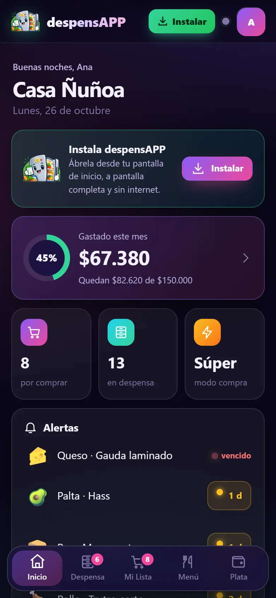
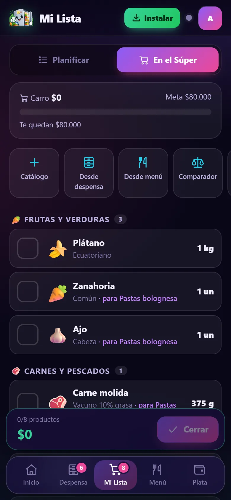
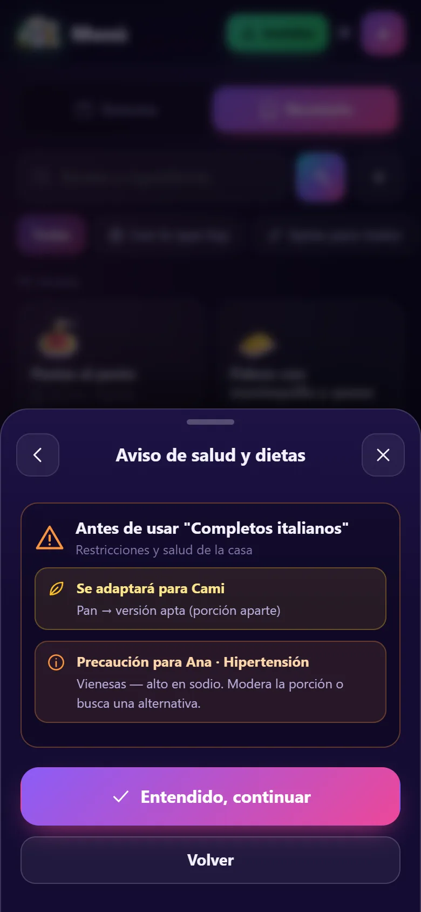
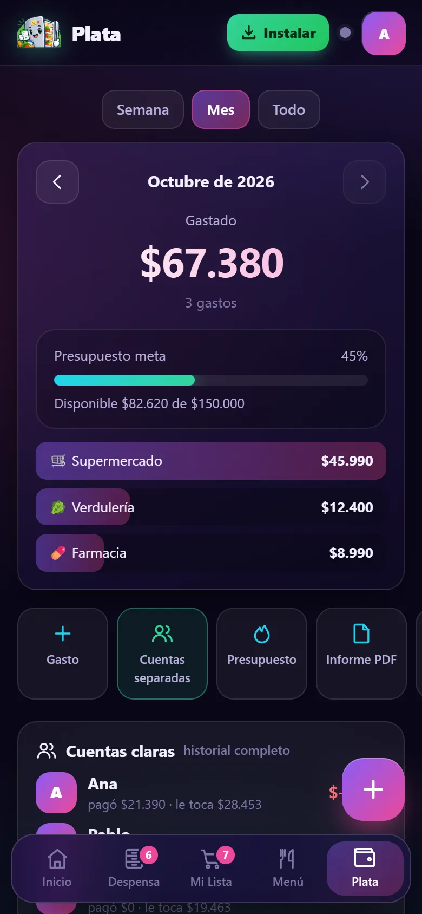

<p align="center">
  
</p>

<h1 align="center">despensAPP</h1>

<p align="center">
  PWA mobile-first para el hogar: despensa, lista del súper con calculadora en vivo, menú con recetas adaptadas a dietas y salud, y finanzas compartidas en tiempo real.
  <br><br>
  <a href="https://despensapp.web.app"><b>Abrir la app</b></a> ·
  <a href="https://despensapp.web.app/manual/"><b>Manual de uso</b></a>
</p>

<p align="center">
  
  
  
  
</p>

## El problema

En una casa se compra de más, la comida vence en el refrigerador y el presupuesto del supermercado se pasa sin darse cuenta. despensAPP conecta tres cosas que normalmente están separadas: **lo que hay en casa**, **lo que hay que comprar** y **la plata**.

## Funcionalidades

- **Despensa**: cantidades en varias unidades (g, kg, ml, L, un), semáforo de vencimiento, stock mínimo con sugerencias de reposición y exportación por WhatsApp o imagen.
- **Catálogo chileno**: 20 categorías y más de 330 productos con variantes, basado en las categorías de supermercados chilenos. Permite crear productos y variantes propios.
- **Mi Lista y Modo Súper**: precio real en el pasillo, ofertas (2×1, 3×2, % de descuento), precio por kilo o litro, comparador de formatos y termómetro de presupuesto. Al cerrar la compra, los productos pasan a la despensa y se crea un borrador de gasto.
- **Menú y recetario**: 95 recetas escalables por número de personas que revisan la despensa y envían a la lista **solo lo que falta**.
- **Dietas y salud**: alergias, dietas, condiciones de salud (hipertensión, diabetes, colesterol, gota, embarazo, etc.) y alimentos prohibidos por persona. Antes de usar una receta aparece un aviso, y se proponen versiones aptas (porción aparte o todo el plato).
- **Finanzas**: presupuesto meta, gastos con foto de boleta (lectura del total con OCR opcional), división de gastos entre integrantes, **cuentas separadas por boleta** (por productos, personas externas y aportes de varios pagadores) con sugerencias para quedar a mano, informe PDF con anexo de boletas y CSV para Excel.
- **Hogar compartido**: sincronización en tiempo real entre teléfonos con un código o QR, avisos de actividad y bitácora. Varios hogares en el mismo teléfono.
- **PWA**: instalable, funciona sin conexión y avisa cuando hay una versión nueva.

## Stack y arquitectura

| | |
|---|---|
| Frontend | HTML, CSS y JavaScript (ES2020) sin frameworks ni build |
| Persistencia local | `localStorage` (estado por hogar) + IndexedDB (fotos comprimidas a 1600 px) |
| Sincronización | Firebase Firestore + Auth anónima; merge por entidad (last-writer-wins con lápidas) |
| Offline | Service Worker: network-first para archivos propios, cache-first para estáticos |
| Exportación | jsPDF + autotable, html2canvas, QR (qrcode.js / jsQR) |
| Herramientas | Puppeteer: capturas del manual y prueba de humo |

```
js/
  catalog.js   Catálogo + motor de dietas y salud
  recipes.js   Recetario, escalado y adaptación según restricciones
  core.js      Unidades, Store (varios hogares), Despensa, Lista, Finanzas
  sync.js      Merge determinista y sincronización con Firestore
  photos.js    Boletas en IndexedDB
  export.js    PDF, CSV y PNG
  ui.js        Hojas inferiores, toasts, confirmación en dos toques
  views/       Inicio, Despensa, Lista, Menú, Plata, Hogar, selector de catálogo
manual/        Manual de uso con capturas
tools/         shots.mjs (capturas) y smoke.mjs (prueba de humo)
```

## Correr en local

El Service Worker no funciona con `file://`, así que hay que servir la carpeta por HTTP:

```bash
python -m http.server 8080    # o: npx serve .
```

Sin configurar Firebase, la app funciona completa en un solo dispositivo.

## Usar tu propio Firebase

1. Crea un proyecto en Firebase, agrega una app **Web** y copia su configuración en `firebase-config.js` como `window.FIREBASE_CONFIG = {...}`.
2. En Authentication, habilita el acceso **Anónimo**.
3. Crea Firestore y publica las reglas: `firebase deploy --only firestore:rules`.

> La configuración web de Firebase (`apiKey`, etc.) es pública por diseño; la seguridad la dan las reglas de `firestore.rules`.

## Pruebas y manual

```bash
cd tools && npm install
node smoke.mjs        # prueba de humo de los flujos principales en Chrome
npm run shots         # regenera las capturas de manual/img
```

## Despliegue

```bash
firebase deploy --only "hosting,firestore:rules"
```

Antes de cada despliegue, sube `VERSION` en `sw.js` y `js/app.js` para que los teléfonos tomen la versión nueva (checklist completo en `CLAUDE.md`).

## Licencia

[MIT](LICENSE) © 2026 Matías Gajardo. Las librerías de `vendor/` conservan sus propias licencias (MIT / Apache 2.0).
